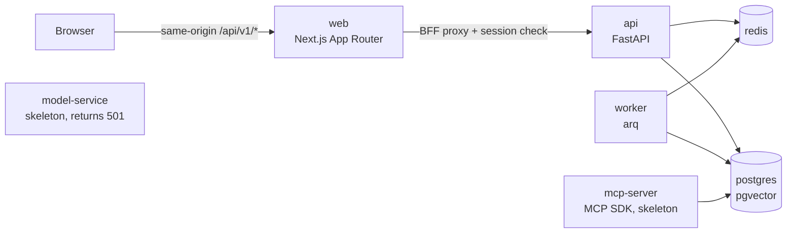

# Compliance Workspace

A full-stack, multi-agent compliance review workspace: upload contracts and vendor
registers, run a versioned rule pack, and get a report whose findings cite the exact
source passage. The full specification is in [`docs/BUILD_HANDOFF.md`](docs/BUILD_HANDOFF.md).

> **Status: Phase 0 (skeleton) only.** What works today: the monorepo, the Docker
> Compose stack with real healthchecks, Postgres migrations, secure cookie-based auth,
> workspace CRUD with role-based membership, the web UI for all of that, and a CI
> workflow. Every CI step has been run locally; a hosted GitHub Actions run is still
> pending.
> Document ingestion, retrieval, the trained model, agents, MCP tools and evals are
> **not implemented yet**. The services reserved for them say so explicitly instead of
> returning fake results. Progress and verification logs are in
> [`docs/BUILD_STATUS.md`](docs/BUILD_STATUS.md).

## Architecture (current)



| Service | Phase 0 behaviour | Healthcheck |
|---|---|---|
| `web` | Sign up / sign in, workspaces list + create, workspace detail (rename, members, delete) | `/healthz`: Next.js serving **and** API reachable via the proxy upstream |
| `api` | `/api/v1/auth/*`, `/api/v1/workspaces/*`, OpenAPI at `/api/v1/docs`; runs migrations on start | `/api/v1/health/ready`: DB query, Alembic at head, pgvector installed, Redis PING |
| `worker` | arq worker; only the diagnostic `ping` job (queue -> worker -> DB) | `arq --check`: worker heartbeat key in Redis |
| `model-service` | **Not implemented** (Phase 3). `/v1/check` validates input, then returns 501 | `/health` must report `mode=not_implemented` |
| `mcp-server` | MCP over streamable HTTP and stdio; **no tools yet** (Phase 5) | Real MCP handshake + `tools/list`, plus DB probe |
| `postgres` | pgvector/pgvector:pg16 | `pg_isready` + `select 1` |
| `redis` | Redis 7.4, AOF | `redis-cli ping` = `PONG` |

Repository layout follows the handoff (section 4): `apps/{web,api,worker,model-service,mcp-server}`,
`packages/{core,ingestion,retrieval,agents,llm}`, `ml/`, `evals/`, `rule_packs/`, `seed/`.
Only `packages/core` has code; the other packages are labelled placeholders.

## Quickstart

Requirements: Docker with Compose v2. For development: [uv](https://docs.astral.sh/uv/)
(it installs Python 3.11) and Node.js 22.

```bash
docker compose up --build --wait     # all 7 services, waits until healthy
open http://localhost:3000           # create an account, then a workspace
```

Ports bind to `127.0.0.1` by default. If a port is in use, override it, e.g.
`WEB_PORT=3300 docker compose up --build --wait`. If your Docker daemon runs with
`iptables: false`, the image builds have no network; set `DOCKER_BUILD_NETWORK=host`.
All variables are documented in [`.env.example`](.env.example).

`make seed` (demo user and documents) is part of Phase 1 and currently exits with
"not implemented".

## Development

```bash
make install          # uv sync --frozen + npm ci
make test-infra-up    # throwaway Postgres/pgvector + Redis on 127.0.0.1:55432/56379
make ci               # lint, typecheck, OpenAPI drift check, pytest, vitest, next build
make up && make smoke # full stack + end-to-end smoke test (use WEB_PORT=... if needed)
make help             # every target
uv run pre-commit install   # optional: ruff, mypy, eslint, tsc hooks on commit
```

- **Python**: uv workspace (`pyproject.toml` at the root). ruff, mypy `--strict`, pytest.
  The integration tests use real Postgres and Redis and **fail** (not skip) if those
  are unavailable.
- **Web**: Next.js 16 App Router, TypeScript strict, Tailwind v4, shadcn/ui-style
  components, TanStack Query, eslint, Vitest + Testing Library.
- **API types**: `make openapi` regenerates `apps/web/src/lib/api/openapi.json` and the
  `openapi-typescript` types. CI fails if either is stale.
- **Migrations**: Alembic lives in `packages/core/src/compliance_core/db/migrations`.
  Run `make migrate`, or `python -m compliance_core.db.migrate upgrade head`.

## Security model (Phase 0)

- Passwords are hashed with Argon2id. Emails are normalised to lowercase, and the
  database enforces that.
- The session is an HS256 JWT in an `httpOnly`, `SameSite=Lax` cookie (`Secure` when
  `COOKIE_SECURE=true`, which production requires). Tokens carry `jti`/`iss`/`aud`/`exp`.
  Logging out or signing in again revokes the old token in Redis.
- CSRF: every cookie-authenticated state change must send `X-CSRF-Token`. The token is
  an HMAC of the session's `jti`, readable from the `cw_csrf` cookie.
- The browser only talks to the web origin. A Next.js route handler proxies
  `/api/v1/*` to the API with an allow-list of headers and rejects path traversal.
- Failed sign-ins are throttled per account (HTTP 429 with `Retry-After`).
- Every workspace endpoint is scoped to membership. Non-members get 404, so a
  workspace's existence is not disclosed. Only owners can rename, delete or manage
  members.
- Errors use one envelope, `{"error": {"code", "message", "details?"}}`. Validation
  errors never echo submitted values.
- Access logs are JSON lines carrying a request id, which is also returned as
  `X-Request-ID`. The API code never logs request bodies.

## Limitations (Phase 0)

- No document, retrieval, model, agent, MCP-tool or eval functionality yet; see the
  phase plan in the handoff.
- Login throttling is per account only. There is no per-IP limit, because the API sits
  behind the web proxy and does not trust forwarded client IPs. Registration is not
  rate limited.
- Members can only be added if they already have an account (no email invitations).
  The add-member error therefore reveals to workspace owners whether an email is
  registered.
- There is no ownership transfer. An owner cannot leave a workspace; they can only
  delete it.
- SSO, billing, multi-tenant cloud deployment, real-time co-editing and non-English
  documents are out of scope (handoff section 16).
