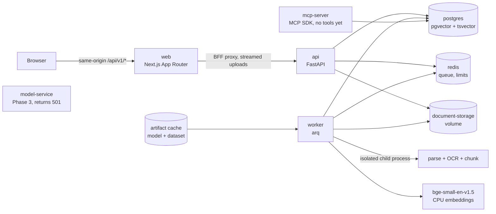

# Compliance Workspace

A full-stack, multi-agent compliance review workspace: upload contracts and vendor
registers, run a versioned rule pack, and get a report whose findings cite the exact
source passage. The full specification is in [`docs/BUILD_HANDOFF.md`](docs/BUILD_HANDOFF.md).

> **Status: Phase 0 accepted; Phase 1 (ingestion + viewer) locally accepted by
> independent verification, with hosted CI still pending.**
>
> - **Phase 0** (skeleton, auth, workspaces, compose, CI) was independently verified and
>   passed hosted GitHub Actions (run 39678264159, commit `e6b709e`).
> - **Phase 1 works today:**
>   - authenticated, role-scoped multi-file uploads, validated and limited while streaming;
>   - sandboxed PDF/OCR/DOCX/XLSX/CSV parsing;
>   - sentence-preserving chunking with exact offsets and boxes;
>   - real local `BAAI/bge-small-en-v1.5` embeddings in pgvector, plus full-text vectors;
>   - the documents page, and a viewer (PDF with text-layer search and precise
>     highlight overlays, spreadsheet table, DOCX source view);
>   - an automatically seeded demo workspace.
> - **Phase 1 is not yet verified on hosted CI.**
> - **Not implemented yet:** retrieval/search (Phase 2), the trained rule-check model
>   (Phase 3), agents/reviews/reports and entity extraction (Phase 4), MCP tools
>   (Phase 5), evals (Phase 6). The services and panels reserved for them say so
>   explicitly instead of returning fake results.
>
> Verification logs are in [`docs/BUILD_STATUS.md`](docs/BUILD_STATUS.md).

## Architecture (current)



| Service | Current behaviour | Healthcheck |
|---|---|---|
| `web` | Auth, workspaces, documents page (drag-and-drop upload with per-file progress, live status), document viewer | `/healthz`: Next.js serving **and** API reachable via the proxy upstream |
| `api` | Auth, workspaces, documents (upload, list, metadata, original file, chunks, pages, blocks, sheets/rows, entities status, delete, retry); runs migrations on start | `/api/v1/health/ready`: DB query, Alembic at head, pgvector installed, Redis PING |
| `worker` | `ingest_document` jobs, stale-document sweep, demo seeding on first start | `arq --check` heartbeat; it only heartbeats after the DB is reachable and the pinned model is SHA-256-verified and loaded |
| `model-service` | **Not implemented** (Phase 3). `/v1/check` validates input, then returns 501 | `/health` must report `mode=not_implemented` |
| `mcp-server` | MCP over streamable HTTP and stdio; **no tools yet** (Phase 5) | Real MCP handshake + `tools/list`, plus DB probe |
| `postgres` | pgvector/pgvector:pg16 | `pg_isready` + `select 1` |
| `redis` | Redis 7.4, AOF | `redis-cli ping` = `PONG` |

## Quickstart

Requirements: Docker with Compose v2. For development: [uv](https://docs.astral.sh/uv/)
(it installs Python 3.11) and Node.js 22.

```bash
docker compose up --build --wait     # all 7 services, waits until healthy
open http://localhost:3000           # sign in as demo@example.com / demo1234
```

On the first clean start, the worker downloads the pinned embedding model (about 130 MB)
and the ContractNLI archive (65 MB) into the `artifact-cache` volume. It verifies both
against pinned SHA-256s, then seeds and ingests the demo workspace: a vendor register plus
ten NDAs, one of them a scanned image-only PDF. `make seed` re-runs seeding idempotently
and waits for ingestion.

Host-specific notes (all variables are documented in [`.env.example`](.env.example)):

- Ports bind to `127.0.0.1`. If one is taken, override it: `WEB_PORT=3300 docker compose up --build --wait`.
- If the Docker daemon runs with `iptables: false`, builds have no network; set
  `DOCKER_BUILD_NETWORK=host`.
- If containers cannot reach the internet, run `make fetch-artifacts` on the host and
  start with `ARTIFACT_CACHE_SOURCE=./.cache ARTIFACT_AUTO_DOWNLOAD=false`.

## Documents and ingestion (Phase 1)

- **Upload**
  - `POST /api/v1/workspaces/{id}/documents` (multipart field `files`). Only owners and
    reviewers can upload; viewers are read-only.
  - The body is streamed with per-file (50 MB), per-request (200 MB), file-count, header
    and field limits.
  - Content is sniffed: the extension must match, and Office zips are checked for bombs,
    encryption, macros and traversal paths.
  - Filenames are sanitised for display; storage keys are server-generated.
  - Rate limiting reserves quota atomically per request and per file attempt.
  - Identical bytes in the same workspace return the existing document, so SHA-256 is
    idempotent per workspace.
- **Ingestion job**
  - Parsing runs in a separate process with a timeout and a memory limit.
  - **PDF:** the PyMuPDF text layer with a box for every character. Pages with almost no
    text are rasterised (a pixel cap is enforced before rendering) and OCR'd with
    Tesseract; word boxes are mapped back to page points.
  - **DOCX:** body paragraphs, headings, lists and tables, with styles.
  - **XLSX/CSV:** a header row is detected even below title rows. Each sheet is stored as
    structured rows, and each row becomes one searchable chunk.
  - **Chunking** splits on headings, numbered clauses and paragraphs, targeting 200–400
    tokens (counted with the embedding tokenizer) with up to 40 tokens of overlap.
  - **Sentences are never split.** A single sentence longer than 400 tokens becomes one
    oversized chunk. If a chunk exceeds the encoder's 512-token context, it is embedded
    in bounded token windows aligned to word starts, and the windows are averaged back
    into one vector. The chunk text itself is never cut or truncated.
  - Every chunk satisfies `text == canonical_text[char_start:char_end]` and carries
    line-level boxes (PDF).
  - Results are written in one transaction that deletes stale derived rows first and
    re-locks the document. Retries never duplicate data, and a deleted document is
    never resurrected.
- **Storage**
  - `vector(384)` with an HNSW index (cosine distance).
  - A generated `tsvector` with a GIN index.
- **Viewer**
  - PDF via react-pdf, using pdf.js's legacy build so current stable browsers are
    supported. It has a text layer, search, and highlight overlays computed from
    stored boxes.
  - Clicking a chunk scrolls to it and highlights it; `?chunk=<id>` deep links work.
  - Spreadsheets render as tables with the selected row highlighted.
  - DOCX shows its extracted body with the chunk's exact characters marked.
  - The Entities panel says plainly that extraction arrives with the Phase 4 review
    pipeline.
- **Document type** (`contract`/`policy`/`other`) is a keyword heuristic on the
  opening text, not a trained classifier.

## Development

```bash
make install           # uv sync --frozen + npm ci
make fetch-artifacts   # pinned model + ContractNLI into ./.cache (needed by tests)
make test-infra-up     # throwaway Postgres/pgvector + Redis on 127.0.0.1:55432/56379
make ci                # lint, typecheck, OpenAPI drift check, pytest, vitest, next build
make up && make seed   # full stack + demo data
make smoke smoke-phase1 WEB_PORT=3000   # end-to-end smoke tests against the stack
make help              # every target
uv run pre-commit install   # optional: ruff, mypy, eslint, tsc hooks on commit
```

- **Python:** a uv workspace (`pyproject.toml` at the root). PyTorch comes from the
  CPU-only index: no CUDA packages are locked or downloaded. Tooling is ruff, mypy
  `--strict` and pytest. Integration tests use real Postgres, Redis, Tesseract and the
  real model, and they **fail** (not skip) if those are unavailable.
- **Web:** Next.js 16 App Router, TypeScript strict, Tailwind v4, shadcn/ui-style
  components, TanStack Query, react-pdf, eslint, Vitest + Testing Library.
- **API types:** `make openapi` regenerates `apps/web/src/lib/api/openapi.json` and the
  `openapi-typescript` types. CI fails if either is stale.
- **Migrations:** Alembic lives in `packages/core/src/compliance_core/db/migrations`.
  `0001` covers identity and workspaces; `0002` covers documents, pages, blocks, sheets,
  rows, chunks and entities. Both are reversible.

## Security model

- **Passwords:** hashed with Argon2id. Emails are normalised to lowercase, and the
  database enforces it.
- **Sessions:** an HS256 JWT in an `httpOnly`, `SameSite=Lax` cookie, which is `Secure`
  when `COOKIE_SECURE=true` (production requires that). Signing out or back in revokes
  the old token in Redis.
- **CSRF:** every cookie-authenticated state change, uploads included, must send a
  session-bound `X-CSRF-Token`.
- **Browser traffic:** goes only to the web origin. The Next.js route handler proxies
  and streams `/api/v1/*` with a header allow-list and rejects path traversal.
- **Scoping:** workspace and document endpoints are scoped to membership. Non-members
  get 404, and viewers cannot upload, delete or retry.
- **Original files:** PDFs are served `inline`, everything else as an `attachment` with
  `CSP: sandbox` and `nosniff`. Text from PDFs is HTML-escaped before it reaches the
  pdf.js text layer.
- **Untrusted documents:** parsed in a resource-limited child process. Document text is
  treated as data and never executed.
- **Logs:** JSON lines with request ids. Ingestion logs ids, counts and timings, never
  document contents.

## Data and licenses

ContractNLI (CC BY 4.0, Koreeda & Manning, 2021) provides the demo NDAs, all from its
test split. The license was checked before download and is recorded, with attribution,
in [`ml/data/LICENSES.md`](ml/data/LICENSES.md). `BAAI/bge-small-en-v1.5` is MIT-licensed.
Raw data, model weights and generated documents are git-ignored and never committed.
The vendor register's access levels and dates are synthetic; see
[`seed/README.md`](seed/README.md).

## Limitations

- No retrieval, trained model, agents, reviews, MCP tools or evals yet; see the phase
  plan in the handoff.
- **OCR:**
  - Tesseract (English) runs only on pages with almost no text layer. Mixed pages
    (some text plus scanned images) are not OCR'd.
  - Pages too large to rasterise at 100 DPI within the 40-megapixel budget are skipped
    with a visible warning.
  - OCR word boxes are divided evenly across characters, so character-level geometry is
    approximate within a word.
- **DOCX:** headers, footers, footnotes, comments and text boxes are not extracted. DOCX
  files have no pages, so their citations use character offsets only.
- **Formats:** encrypted or password-protected PDFs and Office files, macro-enabled
  files, legacy `.doc`/`.xls`, and images are rejected.
- **Highlights on scans:** overlays on OCR'd pages follow Tesseract's line boxes, so a
  skewed scan can be off by a pixel or two.
- **Rate limits:** login throttling is per account only, there is no per-IP limit, and
  registration is not rate limited. Upload limits are per user.
- **Membership:** members must already have an account, so the add-member error
  reveals to owners whether an email is registered. There is no ownership transfer.
- **Deletion:** if the API crashes between the database commit and the file removal,
  the stored original can be orphaned (the row is already gone).
- **Out of scope:** SSO, billing, multi-tenant cloud deployment, real-time co-editing
  and non-English documents (handoff section 16).
